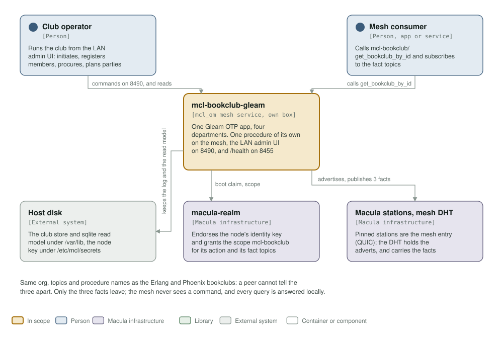
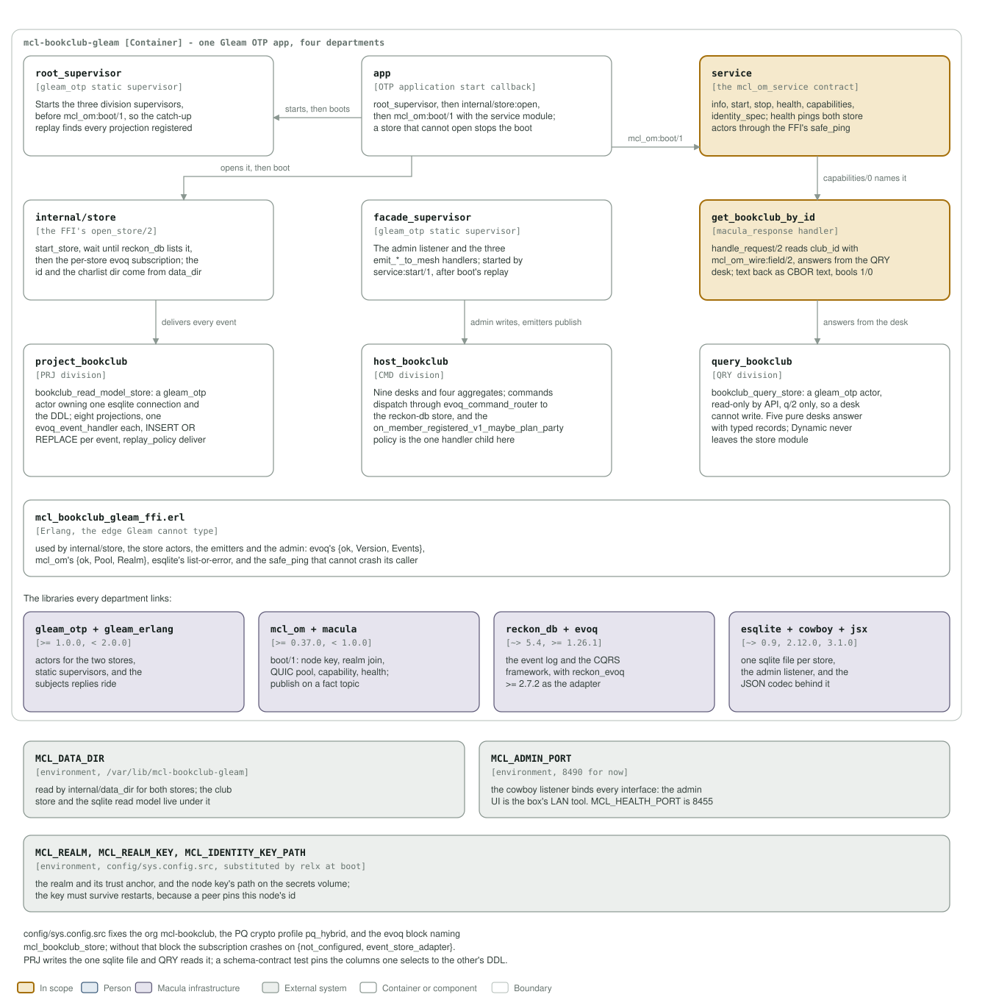

# mcl-bookclub-gleam architecture: C4 model

*This exists so a reader can see what mcl-bookclub-gleam talks to, and what it is
made of, without reading it.*

**Status: the full domain, end to end, in Gleam.** One Gleam OTP app holds four
departments: a facade (the mesh contract, the handler, the emitters, the admin UI),
a CMD division with nine desks, four aggregates and the party policy, a PRJ division
projecting eight events into one sqlite read model, and a QRY division answering
from it. `mcl-bookclub/get_bookclub_by_id` is its own procedure, and the only one;
`mcl-om` adds `mcl-bookclub/info` and `mcl-bookclub/get_limits` to every service,
both open, and `capabilities/0` is the list. The LAN admin UI runs on 8490;
`/health` on 8455.

## Level 1: system context

| Element | Kind | Role |
| --- | --- | --- |
| mcl-bookclub-gleam | In scope | One Gleam OTP app with four departments. Serves `mcl-bookclub/get_bookclub_by_id` on the mesh, the admin UI on 8490, and `/health` on 8455 |
| Club operator | Person | Runs the club from the LAN admin UI: initiates and archives clubs, registers and unregisters members, procures and retires books, starts and finishes readings, plans parties |
| Mesh consumer | Person | Another service or app on the mesh: calls `mcl-bookclub/get_bookclub_by_id` and subscribes to its fact topics |
| Host disk | External system | The club store and the sqlite read model under `/var/lib/mcl-bookclub-gleam`, and the node identity key under `/etc/mcl/secrets`. A recreate without the volumes forgets both the record and the node id |
| macula-realm | Macula infrastructure | Endorses the node's identity key and grants the scope `mcl-bookclub` for its action and its fact topics |
| Macula stations, mesh DHT | Macula infrastructure | The pinned stations are the service's mesh entry points over QUIC; the DHT holds the adverts for its own procedure and for the `info` and `get_limits` mcl-om adds, and carries the fact topics |

Same org, topics and procedure names as the Erlang and Phoenix bookclubs, so a
peer cannot tell the three apart. Only `member_registered_v1`, `book_procured_v1`
and `book_retired_v1` leave, as facts on their own topics; the mesh never sees a
command, and every query is answered from the local read model.

## Level 2: containers and components

| Component | Technology | Responsibility |
| --- | --- | --- |
| `root_supervisor` | `gleam_otp` static supervisor | Starts the three division supervisors before `mcl_om:boot/1`, so the subscription's catch-up replay finds every `deliver`-policy projection registered. The single-app equivalent of the twins' umbrella start order |
| `app` | OTP application start callback | `root_supervisor`, then `internal/store:open`, then `mcl_om:boot/1` with the service module. A store that cannot open stops the boot naming why |
| `service` | the `mcl_om_service` contract | `info/0`, `start/1`, `stop/1`, `health/0`, `capabilities/0`, `identity_spec/0`. `health/0` pings both store actors through the FFI's `safe_ping/2`, which cannot crash the caller |
| `internal/store` | the FFI's `open_store/2` | Starts the store, waits until reckon_db lists it, then starts the per-store evoq subscription. The id and the charlist dir come from `internal/data_dir` |
| `facade_supervisor` | `gleam_otp` static supervisor | The admin listener and the three `emit_*_to_mesh` handlers. Started by `service:start/1`, after boot's replay |
| `get_bookclub_by_id` | `macula_response` handler | `handle_request/2` reads `club_id` with `mcl_om_wire:field/2` and answers from the QRY desk; text goes back as CBOR text and booleans as 1/0 |
| `project_bookclub` | PRJ division | `bookclub_read_model_store`: a `gleam_otp` actor owning one esqlite connection and the DDL. Eight projections, one `evoq_event_handler` each, one `INSERT OR REPLACE` per event, `replay_policy deliver` |
| `host_bookclub` | CMD division | Nine desks and four aggregates; commands dispatch through `evoq_command_router` to the reckon-db store. `on_member_registered_v1_maybe_plan_party` is the one handler child the division supervises |
| `query_bookclub` | QRY division | `bookclub_query_store`: a `gleam_otp` actor, read-only by API (`q/2` only), so a desk cannot write. Five pure desks answer with typed records, each converting the `Dynamic` cells `q/2` returns to typed fields |
| `mcl_bookclub_gleam_ffi.erl` | Erlang, the edge Gleam cannot type | Used by `internal/store`, the store actors, the emitters and the admin: evoq's `{ok, Version, Events}`, `mcl_om`'s `{ok, Pool, Realm}`, esqlite's list-or-error, and `safe_ping/2` |
| `gleam_otp` + `gleam_erlang` | libraries, `>= 1.0.0, < 2.0.0` | Actors for the two stores, static supervisors, and the subjects replies ride |
| `mcl_om` + `macula` | libraries, `>= 0.37.0, < 1.0.0` for `mcl_om`; `macula` comes in through it. The floor is `mcl_om` 0.37.0, which needs `~> 13.3`; no `manifest.toml` is committed, so a build resolves the newest `mcl_om` below 1.0.0 (0.42.0 today), which needs `~> 14.11` | `boot/1`: node key, realm join, QUIC pool, adverts, health; publish on a fact topic |
| `reckon_db` + `evoq` | libraries, `~> 5.4` and `>= 1.26.1` | The event log and the CQRS framework, with `reckon_evoq` `>= 2.7.2` as the adapter evoq reads the log through |
| `esqlite` + `cowboy` + `jsx` | libraries, `~> 0.9`, `2.12.0`, `3.1.0` | One sqlite file per store, the admin listener, and the JSON codec behind it |
| `MCL_DATA_DIR` | environment | Read by `internal/data_dir` for both stores. `/var/lib/mcl-bookclub-gleam` in the image; the club store and `bookclub.sqlite3` live under it |
| `MCL_ADMIN_PORT` | environment | The cowboy listener's port, 8490 for now. It binds every interface, because the admin UI is the box's LAN tool. `MCL_HEALTH_PORT` is 8455 |
| `MCL_REALM`, `MCL_REALM_KEY`, `MCL_IDENTITY_KEY_PATH` | environment | The realm and its trust anchor, and the node key's path on the secrets volume. The key must survive restarts, because a peer pins this node's id |

`config/sys.config.src` fixes the org `mcl-bookclub`, the PQ crypto profile
`pq_hybrid`, and the `evoq` block naming `mcl_bookclub_store`; without that block
the subscription crashes on `{not_configured, event_store_adapter}`. PRJ writes the
one sqlite file and QRY reads it, and a schema-contract test pins the columns one
selects to the DDL the other declares.

**Where the station list comes from.** It is not in `config/sys.config.src`: `mcl_om` reads `MACULA_STATION_SEEDS` and `MACULA_STATION_NODE_IDS` from the environment at boot, paired index for index, so this repository pins no station and the list may be any length.

## Drawing them

`assets/c4-context.svg` and `assets/c4-components.svg` are generated by
`architecture/c4_diagrams.py` (`python3 architecture/c4_diagrams.py`), from the
code and never from this page: the contract in `service.gleam`, the boot order in
`app.gleam` and `root_supervisor.gleam`, the facade tree in
`facade_supervisor.gleam`, the handler in `get_bookclub_by_id.gleam`, the routes in
`admin.gleam`, the three division supervisors, the bindings under `internal/`, the
dependencies in `gleam.toml`, and the ports and volumes in the `Containerfile`.
When one of those changes, the diagram changes in the same commit.

Two rules for the files themselves, so they render everywhere they are read
(GitHub, an IDE, `rsvg-convert`): self-contained SVG, and literal colours in plain
classes plus a `prefers-color-scheme` dark block, never CSS custom properties,
which `rsvg-convert` renders black.

The check that keeps them here is the `c4-model` job in
`.github/workflows/c4-model.yml`. It is red until both files exist and are shown, and it
stays red if either one goes missing.
